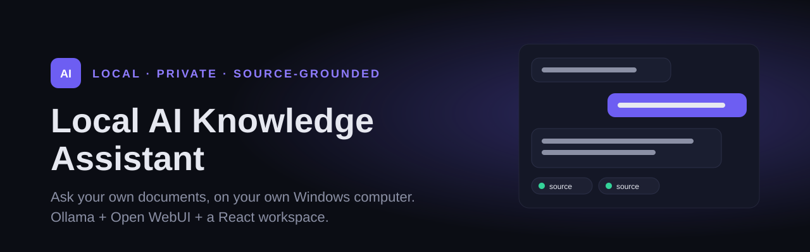
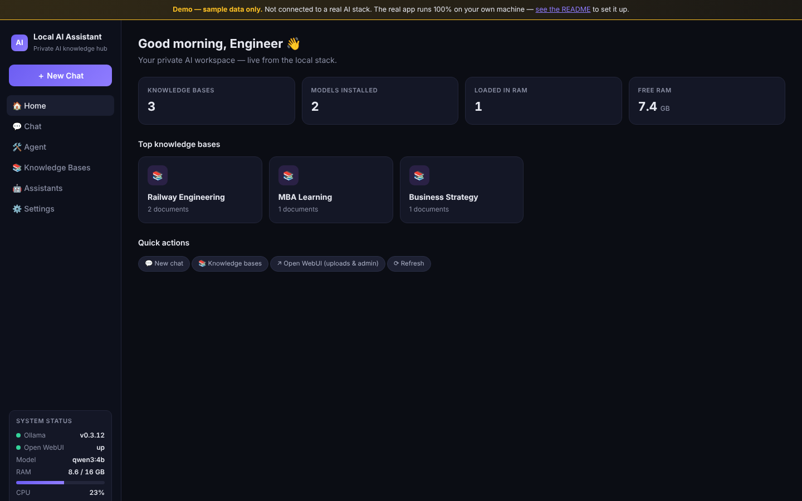
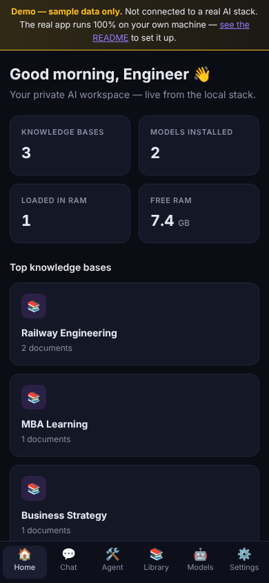
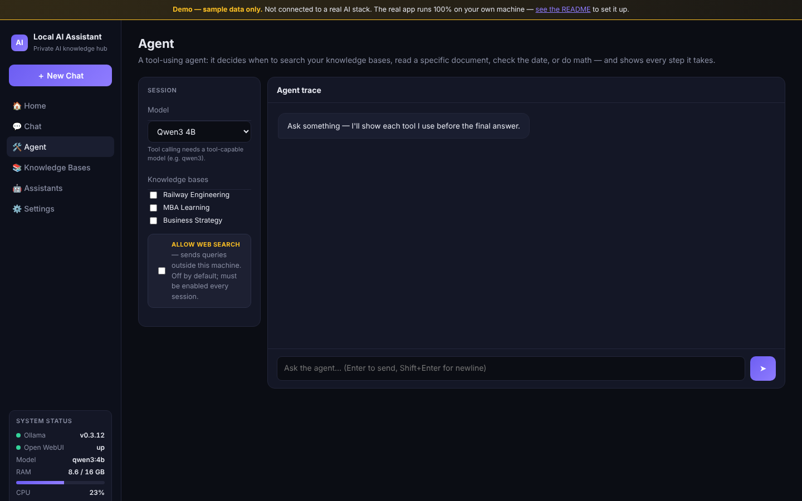

<p align="center"></p>

# Local AI Knowledge Assistant

**Ask useful questions of your own documents, on your own Windows computer.** This repository combines a staged Windows setup kit with a React interface for Ollama and Open WebUI.


[Start safely](docs/GETTING_STARTED.md) · [Frontend guide](frontend/README.md) · [Implementation plan](docs/00-implementation-plan.md) · [Retrieval tests](docs/07-retrieval-testing.md)

## The problem it addresses

A collection of reports, study material and reference documents is only useful if you can find the relevant passage, understand its source and recognize when the answer is missing. The kit is designed around small local models, measured resource use and source-grounded retrieval rather than choosing the largest model that can load.

The intended baseline is a resource-constrained Windows 11 computer. Benchmark the actual machine; do not assume GPU/NPU acceleration or that a model size will fit merely because it is listed in a guide.

## What is included

- **A gated installation path:** PowerShell readiness, model benchmark, startup, shutdown, status, privacy-check and backup scripts.
- **Local document retrieval:** Open WebUI knowledge collections and Ollama-hosted models/embeddings, configured through the existing guides.
- **A React workspace:** home/status view, streaming chat, knowledge-base and document listings, assistant selection and settings.
- **A tool-using agent implementation:** knowledge search, document reading, arithmetic, date/time and an optional external web-search path, with a visible execution trace.
- **Arabic and English workflows:** benchmark prompts and retrieval validation guidance, with direction-aware chat rendering.
- **A separate public preview build:** the same interface backed by canned data. It is not the private local assistant.

## Screenshots

These come from the **public sample-data preview** (`frontend/build/build-demo.mjs`), not from a private installation. The numbers, libraries and status values are canned demo data.

| Desktop (1440 x 900) | Mobile (390 x 844) |
|---|---|
|  |  |

Agent view with the web-search opt-in off by default:



On screens narrower than 760 px the sidebar is replaced by a bottom tab bar with the same destinations.

## Architecture

| Component | Default address | Responsibility |
| --- | --- | --- |
| Ollama | `127.0.0.1:11434` | Model runtime |
| Open WebUI | `127.0.0.1:8080` | Account, knowledge collections, document ingestion and RAG |
| Python frontend server | `127.0.0.1:8090` | Serve bundled React assets and proxy the local APIs |
| React frontend | Through the Python server | Chat, library inspection, status and agent trace |

The frontend server binds to loopback. Its `OWUI_URL` and `OLLAMA_URL` environment overrides must remain local to retain this intended boundary. Do not add a public tunnel or expose the services to make a hosted preview behave like the real app.

## Current status and important limits

This is an implementation kit plus application source, **not evidence that the ten setup gates have passed on a particular computer**.

- The committed `frontend/dist/` bundle lets the real UI run without Node.js on the target computer. Python and the functioning local services are still needed.
- Document upload and knowledge-base administration belong in Open WebUI, not a second frontend database.
- The installer and startup scripts currently reference `open-webui@latest`. A reproducible supported installation still needs a tested version recorded/pinned and a restore rehearsal.
- The frontend stores its Open WebUI API key in browser localStorage. Treat the browser profile and computer as part of the security boundary.
- **Agent web-search boundary:** the dispatcher includes `web_search` only for an explicit boolean opt-in. Disabled or unknown calls are rejected before a handler runs; malformed `allowWeb` request values return HTTP 400. Offline regression tests cover this boundary and selected-library scope. This is not a full system no-egress audit.
- The real local application is not deployable as a working static Vercel/GitHub Pages site. A public build uses synthetic data and has no access to your local libraries.

The setup review started from [`df4e30c`](https://github.com/ahmadzayan-hub/AI-Knowledge-Assistant/tree/df4e30cf74617410cc4d707f0de9c36e25bb9f24), on the default branch `claude/local-ai-windows-setup-yv2ekh`; this revision adds the dispatch guard and offline tests. No Windows installation, private-document ingestion or live acceptance test is claimed.

## Start on Windows

From PowerShell, clone the actual repository and enter its root:

```powershell
git clone https://github.com/ahmadzayan-hub/AI-Knowledge-Assistant.git
cd AI-Knowledge-Assistant
.\scripts\00-audit.ps1
```

The audit inspects the machine and writes a local report under `reports/`; it does not install the stack. Review its output before proceeding. If script execution is blocked, inspect the script and follow the computer's approved PowerShell policy rather than changing machine-wide security settings.

Continue through the gates below. Installers download software/models and write local data; they are not read-only checks. No paid AI provider is required for the local baseline.

When the stack has already passed its setup gates:

```powershell
.\scripts\start-ai.ps1
.\scripts\status.ps1
.\scripts\start-frontend.ps1
```

Open `http://127.0.0.1:8090`. Configure the frontend's connection to your local Open WebUI account as described in [frontend/README.md](frontend/README.md). Never commit its API key or include it in support screenshots.

## Work through the gates

| Gate | Evidence to establish | Starting point |
| --- | --- | --- |
| 1 | Windows resources and prerequisites are adequate | [Readiness](docs/01-system-readiness.md), [audit script](scripts/00-audit.ps1) |
| 2 | Ollama runs on loopback | [Ollama setup script](scripts/02-install-ollama.ps1) |
| 3 | A modest model is stable on this machine | [Model strategy](docs/02-model-strategy.md), [benchmark script](scripts/03-benchmark.ps1) |
| 4 | Open WebUI accounts, chat and restart persistence work | [Deployment guide](docs/03-openwebui-deployment.md) |
| 5 | One permitted test document is correctly indexed | [RAG configuration](docs/04-rag-configuration.md) |
| 6–8 | Supported answers, unsupported-question refusal and Arabic/English retrieval are checked | [Retrieval testing](docs/07-retrieval-testing.md) |
| 9 | Network exposure, account access and data flows are reviewed | [Security guide](docs/08-security-privacy.md), [privacy check](scripts/05-privacy-check.ps1) |
| 10 | Backup and restore are demonstrated | [Operations](docs/09-operations.md), [backup/update guide](docs/11-backup-updates.md) |

The agent is an additional capability after the baseline, not a shortcut around those gates. See its [design and permission notes](docs/15-agent-orchestration.md).

## Run the offline permission tests

From the repository root with Python 3.11 or 3.12:

```powershell
python -m unittest discover -s frontend/tests -v
```

The tests use Python's standard library, synthetic model responses and mocked transport. They require no package install, model download, API key or running service, and assert that no real network request occurs. They cover disabled/enabled/unknown tool calls, strict request booleans, per-run permission isolation and selected-library scope. There is no committed CI workflow; these focused tests do not replace the Windows install, retrieval and restore gates.

## Rebuild the frontend

Node.js is required only on the machine rebuilding the React bundle:

```powershell
cd frontend
npm install
npm run build
```

The manifest declares `build`, not root-level `dev` or `test` scripts. There is no committed npm lockfile in this frontend, so `npm ci` is not the documented install command. The real build writes `frontend/dist/`; preserve these committed assets when changing the UI.

For the separate, clearly labelled sample preview, see [the preview boundary](docs/GETTING_STARTED.md#public-preview-is-not-the-local-product). Never publish real documents, account data or API keys with that output.

## Scripts and checks

| Command (run in `frontend/`) | Purpose |
|---|---|
| `npm run build` | Build the real local bundle into `frontend/dist/` |
| `node build/build-demo.mjs` | Build the sample-data preview into `frontend/demo-dist/` |
| `python -m unittest discover -s frontend/tests -v` (from the repository root) | Offline agent permission tests |

## Deploy the public preview on Vercel

Only the sample-data preview can be hosted. It has no access to your local libraries, models or API keys. `frontend/vercel.json` pins the settings:

| Setting | Value |
|---|---|
| Framework preset | Other |
| Root directory | `frontend` |
| Install command | `npm install` |
| Build command | `node build/build-demo.mjs` |
| Output directory | `demo-dist` |
| Environment variables | none |

Do not point a hosted build at the real `npm run build` output, and do not expose the local services through a tunnel.

## Repository map and operations

- `docs/00–12`: plan, machine readiness, models, deployment, RAG, libraries, assistants, tests, security, operation, troubleshooting, backups and a final-report template.
- `docs/13–15`: UI blueprint, design-generation prompt and agent architecture.
- `scripts/`: the Windows operating toolkit, including `stop-ai.ps1` and `backup.ps1`.
- `frontend/src/`: React source (components include a sidebar and a mobile bottom tab bar); `frontend/dist/`: shipped real bundle.
- `frontend/build/`: real and sample-data build scripts; `frontend/vercel.json`: preview hosting settings.
- `frontend/server.py` and `frontend/agent.py`: local Python service and agent logic.
- `benchmarks/prompts.json`: bilingual benchmark inputs.
- `reports/`: locally generated operational reports, intentionally gitignored.

Keep private libraries, logs, backup contents and personal system reports out of the public repository. The [setup guide](docs/GETTING_STARTED.md) records the remaining acceptance boundaries without changing existing scripts or assets.

## Arabic summary

<div dir="rtl" lang="ar">

مساعد معرفة محلي لويندوز يجمع مستنداتك في مكتبات قابلة للبحث، مع واجهة React ونماذج تعمل عبر Ollama وOpen WebUI. الهدف إجابة يمكن الرجوع إلى مصدرها، واختبار الأداء والخصوصية على الجهاز فعلياً.

النسخة الحقيقية تعمل محلياً؛ العرض المنشور ببيانات جاهزة ليس بديلاً عنها. تثبيت المكونات لا يثبت صحة الاسترجاع أو النسخ الاحتياطي. يفرض منفّذ أدوات Agent الآن منع البحث الخارجي ما لم يُفعّل بقيمة منطقية صريحة، وتغطي اختبارات محلية هذا الحدّ دون إجراء اتصالات فعلية. هذا لا يغني عن اختبار التثبيت والاسترجاع والاستعادة على ويندوز ومراجعة خصوصية النظام كاملاً. احتفظ بمفاتيح الوصول والملفات الخاصة خارج GitHub.

</div>

## Licensing

No repository-wide `LICENSE` file is present in the reviewed tree. No license is added here; all rights remain with the owner, Ahmed Zaian.
